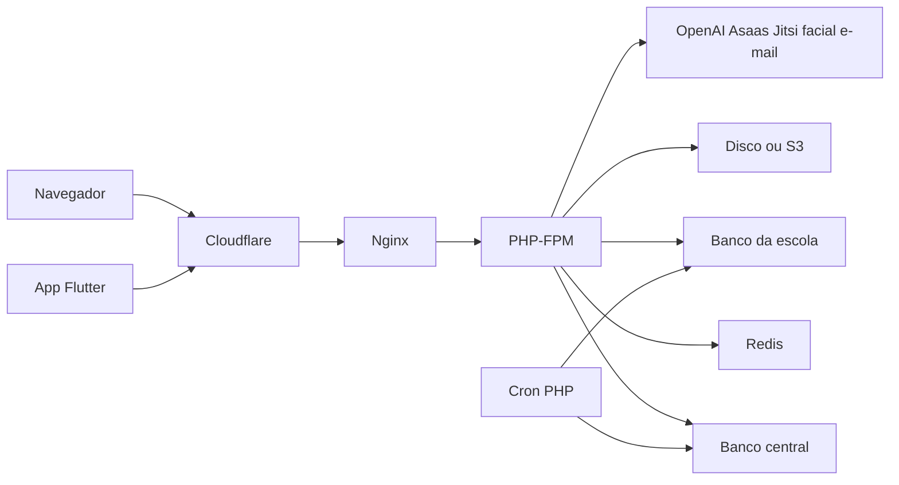

# Levantamento técnico EducaTudo — 19/11/2026

Documento de leitura do repositório para a Conexia. Nada foi alterado no código. Segredos, IPs, hosts internos e dados pessoais não foram copiados.

Classificação:

- `[CONFIRMADO NO CÓDIGO]`: visto no repositório.
- `[INFERIDO]`: dedução, com a origem.
- `[LUCAS RESPONDE]`: depende de servidor, log, painel ou negócio. O resultado fica em branco.

O nome **EducAssist** não existe no repositório. O assistente que grava dados com confirmação e permissão do admin está em `AssistenteAcaoPropostaService`. A tutora do aluno é a **Tudinha**.

---

## Parte A — Arquitetura

### A1. Componentes e fluxo

`[CONFIRMADO NO CÓDIGO]` Componentes que o repositório descreve:

| Componente | Onde |
|---|---|
| Nginx na frente do PHP | `docker-compose.vps.yml` (serviço `nginx`, imagem `nginx:1.27-alpine`); docroot `backend/public` em `docker/nginx/vps-prod-http.conf:14` |
| PHP-FPM | `docker/php/Dockerfile:1` (`php:8.4-fpm`); upstream `php:9000` em `docker/nginx/vps-prod-http.conf:5-7`; até 50 filhos em `docker/php/www.conf:9` |
| MySQL da aplicação | Compose de produção **não** sobe MySQL (`docker-compose.vps.yml:1-4`). O local sobe `mysql:8.0` (`docker-compose.yml:39-41`). A conexão de cada escola sai de `config_escolas_banco` (`backend/app/Core/DatabaseManager.php:86-98`) |
| Redis | `docker-compose.vps.yml` serviço `redis`, imagem `redis:7-alpine`; usado no mapa de escola (`backend/app/Core/TenantResolver.php:106-132`) |
| Arquivos | Disco em `storage/files/{slug}/` (`backend/app/Infra/Services/MediaStorageService.php:147-160`) ou S3 se `MEDIA_STORAGE=s3` (variável em `backend/.env.example`, serviço AWS SDK no `composer.json`) |
| Fila | Não há broker. Jobs de IA são cron PHP: `backend/cron/process_ai_jobs.php` |
| Cron | `backend/cron/` (backup, jornadas, créditos, financeiro, Asaas, RSS, presença, gabarito, KPIs) |
| App dos pais | `familia/` (Flutter, HTTP via Dio no `pubspec.yaml`) |
| Satélites | `services/apostila-ai`, `services/educasync-solver`, `ws-server/` |
| Entrada pública | Comentário de produção cita Cloudflare em `docker/nginx/vps-prod-http.conf:2-3`. O proxy da Oracle não está neste repositório |

`[LUCAS RESPONDE]` Nome comercial do MySQL em produção (MySQL Enterprise na Oracle), se o Object Storage da Oracle está ligado, e se o proxy da Oracle restringe origem. O repositório só mostra MySQL remoto e S3 opcional.



Caminho de um pedido web `[CONFIRMADO NO CÓDIGO]`:

1. Nginx manda o que não é arquivo estático para `index.php` (`docker/nginx/vps-prod-http.conf:79-87`).
2. `backend/bootstrap/app.php:777-779` inclui `bootstrap_multi_tenant.php` antes da aplicação.
3. Domínio master abre o banco central; outro host resolve a escola e troca o PDO (`backend/app/Core/bootstrap_multi_tenant.php:60-77` e `educatudo_definir_constantes_tenant` nas linhas 95-107).
4. `App` dispara `Router::dispatch()` (`backend/app/Core/Router.php:121`).
5. Middleware de sessão/JWT, controller, service, model.

O app Flutter não abre banco. Fala com `/api/v1/...` (`backend/config/routes/api_v1.php:28`).

### A2. Versões

`[CONFIRMADO NO CÓDIGO]`

| Peça | Versão no repositório |
|---|---|
| PHP de execução | imagem `php:8.4-fpm` (`docker/php/Dockerfile:1`); pin de plataforma `8.4.24` (`backend/composer.json:107`) |
| PHP mínimo declarado | `>=8.0` (`backend/composer.json:13`) |
| Nginx | `nginx:1.27-alpine` (`docker-compose.yml:3` e `docker-compose.vps.yml`) |
| Redis | `redis:7-alpine` (tag flutuante, sem patch) |
| MySQL local | `mysql:8.0` só no compose de desenvolvimento (`docker-compose.yml:40`) |
| MySQL de produção | não fixado; host vem do ambiente |
| Composer | aws-sdk `^3`, phpmailer `^6.9`, dompdf `^3.1`, google apiclient `^2.18`, htmlpurifier `^4.16`, phpunit `^9` (`backend/composer.json`) |
| JS da plataforma | Tailwind `^3.4.17`, MathLive `^0.98.2` (`backend/package.json`) |
| Teste E2E | Playwright `^1.51.0` (`package.json`) |
| App pais | versão `1.0.1+2`, Dart `^3.12.2`, Dio `^5.9.2` (`familia/pubspec.yaml:19-37`) |
| Presença | Node, pacote `ws` (`ws-server/package.json`) |

`[INFERIDO]` PHP 8.0 (mínimo do Composer) está fora de suporte desde novembro de 2023. A imagem que o projeto constrói é 8.4, então o runtime do Docker não é o 8.0. MySQL 8.0 da imagem **local** passou do fim do suporte comunitário em abril de 2026; isso não prova a versão do banco gerenciado. Nginx 1.27 é ramo mainline antigo em relação ao ramo atual; a tag não traz patch.

`[LUCAS RESPONDE]` Versão exata em produção (PHP, Nginx, Redis, MySQL Enterprise) e o resultado de `composer audit`. Este levantamento não varreu CVE.

### A3. Multi-escola

**Identificação pelo domínio.** `[CONFIRMADO NO CÓDIGO]` `TenantResolver::resolveTenant()` (`backend/app/Core/TenantResolver.php:54-81`) lê o host em `hostFromRequest()` (linhas 135-141) e consulta `escolas.dominio` em `resolveByDominio()` (linhas 179-193). Em produção o header `X-Tenant` é ignorado (`slugFromHeader()`, linhas 147-150). Fora de produção o header tem prioridade.

**Conexão.** `[CONFIRMADO NO CÓDIGO]` `DatabaseManager::createConnectionFromConfig()` (`backend/app/Core/DatabaseManager.php:48`) abre o PDO com a linha de `config_escolas_banco` (host, porta, nome, usuário, senha cifrada, charset; linhas 97-98 e 196). O banco central guarda o cadastro da escola e essa credencial. Cache Redis `tenant_<host>` por 60 s (`TenantResolver.php:68` e `109-113`) e `tenant_config_<id>` por 300 s (`DatabaseManager.php:104`).

**Escola errada ou mais de uma.** `[CONFIRMADO NO CÓDIGO]`

- Host sem escola: HTTP 404, sem abrir banco de outra escola (`bootstrap_multi_tenant.php:135-168`).
- Escola inativa: HTTP 403 (`bootstrap_multi_tenant.php:110-131`).
- Cache Redis é aceito sem nova consulta ao central (`TenantResolver.php:121-131`). Se o Redis for gravado com o par errado, o processo usa esse par até o TTL. `[INFERIDO]` a partir desse código; o Redis do compose não é publicado na internet (`docker-compose.vps.yml` prende a porta em 127.0.0.1).
- O mesmo worker PHP atende várias escolas. Cache `static` sem a chave de `workerCacheKey()` (`TenantResolver.php:13-23`) pode vazar dado de uma escola para a próxima. É um risco de manutenção, não um furo já apontado numa função concreta além do comentário.
- Cron percorre escolas uma a uma (`backend/cron/backup.php:38-39` carrega o helper). `[CONFIRMADO NO CÓDIGO]` o helper existe; a regra de pular banco igual ao central está documentada no código do helper, não reaberta aqui linha a linha.

**Entrar como.** `[CONFIRMADO NO CÓDIGO]` Só o painel master emite o token (`backend/config/routes/master.php:131` → `MasterEscolaDetailController::entrarComo`). O uso é `GET /auth/entrar-como` (`backend/config/routes/public.php:75`). O token HMAC exige `escola_id` igual ao `TENANT_ID` do host (`AuthController.php:1318-1320`). Não atravessa escola. Exige `jti` de uso único no Redis; se o Redis não gravar, o token é recusado (`AuthController.php:1328-1343`). A sessão marca `impersonated_by_master` (linha 1395) e grava auditoria `entrar_como_master` (linhas 1416-1430) no banco da escola. Quem pode emitir é quem está logado no master; o repositório não lista nomes.

### A4. Arquivos

**Onde ficam.** `[CONFIRMADO NO CÓDIGO]` Caminho local com slug da escola em `MediaStorageService::localBasePath()` (`backend/app/Infra/Services/MediaStorageService.php:151-160`): `storage/files/{slug}/{tipo}`. S3 é o outro modo, pela configuração de mídia. `[LUCAS RESPONDE]` se produção está em disco local, S3 ou Object Storage da Oracle.

**Separação.** O slug entra no caminho nessa função. Uploads antigos em `public/uploads/` são outro tronco, entregues pelo bootstrap depois da escola resolvida (`backend/bootstrap/app.php:781-819`).

**Pastas de `/uploads/` tratadas pelo código** (`AcessoArquivoPrivado::pastaDireta`, `backend/app/Infra/Services/AcessoArquivoPrivado.php:61-118`):

| Prefixo | Decisão no código |
|---|---|
| `uploads/jornadas/exercicios/`, `uploads/provas/questoes/` | rota com sessão e vínculo |
| `uploads/cadernos_aluno/` | negado (Nginx também devolve 404: `docker/nginx/vps-prod-http.conf:33-35`) |
| `uploads/redacoes/` (exceto temas), `arquivos/`, `mensagens/`, `essays/submissions/`, `essays/feedback_audio/`, `tickets/`, `documentos/`, `videos/`, `apostilas/`, `notifications/` | privado |
| `uploads/layout/`, `essays/proposals/`, `redacoes_temas/` | público |
| `uploads/minicursos/`, `expo-colag/`, `ingles/` | exige sessão |
| qualquer outra pasta | negado |

Reconhecimento facial não aparece como pasta de `/uploads/`. A API de amostra facial está em `/api/v1/facial-device/...` (`backend/config/routes/api_v1.php:12-25`). `[LUCAS RESPONDE]` onde o binário da face é guardado no serviço externo.

**Controle de acesso hoje.** `[CONFIRMADO NO CÓDIGO]`

- Nginx não entrega `/uploads/` como arquivo: reescreve para `index.php` (`docker/nginx/vps-prod-http.conf:47-48`).
- Exercício: `ServeImagemExercicioController::serve` exige sessão (linhas 27-31) e `AcessoArquivoPrivado::podeLer` (linhas 32-36).
- Mídia: `MediaServeController::serve` deixa sem login só `layout`, `dashboard_sliders`, `professores`, `avatars`, `essays_proposals` (`MediaServeController.php:41-47` e `82-86`). O resto exige sessão e `podeLer`.
- Ainda sai sem login, de propósito: layout, tema de redação, proposta, e o alias `/storage/images/` no Nginx (`docker/nginx/vps-prod-http.conf:63-66`) mais a leitura em `bootstrap/app.php:760-771`.

### A5. Inteligência artificial

**Tudinha.** `[CONFIRMADO NO CÓDIGO]` Provedor OpenAI. Modelo padrão `gpt-4o-mini` no parâmetro de `TudinhaService::gerarExplicacaoSemHistorico` (`backend/app/Infra/Services/TudinhaService.php:382-405`). A chave vem de variável de ambiente ou da configuração da escola (mensagem na linha 391). Há também chaves Gemini e ElevenLabs no exemplo de ambiente; não são o padrão desse método.

O texto enviado é a mensagem do usuário mais o system prompt (linhas 393-405). A conversa do aluno é gravada em `tudinha_conversas` e `tudinha_mensagens` (`backend/app/Painel/User/Controllers/StudentController.php:2503` e `2724`). Não há prazo de apagamento nesse trecho. `[LUCAS RESPONDE]` retenção e se o contrato da OpenAI permite treino.

**Assistente administrativo (candidato a EducAssist).** `[CONFIRMADO NO CÓDIGO]` `[INFERIDO]` o nome EducAssist não está no código; o comportamento pedido bate com este serviço. `AssistenteAcaoPropostaService` diz que nada grava sem `confirmar=1` do autor (`backend/app/Painel/Admin/Services/AssistenteAcaoPropostaService.php:21` e `confirmar` na linha 575). A permissão usada é a do usuário logado, via `AdminPermissionMatrix::effectivePermissionsForUser` e `can` (linhas 1540-1565), para ocorrência, presença e diário. Histórico em `assistente_conversas` e `assistente_mensagens` (`AssistenteHistoricoService.php:20-25`). Sem prazo de retenção no código lido.

### A6. Autenticação e permissões

`[CONFIRMADO NO CÓDIGO]`

| Perfil | Como entra |
|---|---|
| Aluno, professor, admin da escola, monitor, responsável no site | Sessão `EDUCATUDO_SESSION`. `POST /login` → `AuthController::autenticar` (`backend/config/routes/public.php:73`, `AuthController.php:822`) |
| Responsável no app | JWT. `POST /api/v1/auth/login` (`api_v1.php:28`, `MobileAuthController.php:28`) |
| Responsável na API antiga | `POST /api/auth/login` (`public.php:39`) |
| Master | Sessão no banco central, rotas `/master` |

Senha: `password_hash(..., PASSWORD_DEFAULT)` e `password_verify` (`AuthController.php:505`, `AuthManager.php:228` e `263`). Política geral: mínimo 8 (`backend/config/app.php:116`). No primeiro acesso do aluno o mínimo no código é 6, com maiúscula, minúscula, número e símbolo (`AuthController.php:478-484`).

`AdminPermissionMatrix` não é só menu. `AuthMiddleware` resolve módulo e ação da URL e, se não houver permissão, redireciona para o dashboard (`backend/app/Middleware/AuthMiddleware.php:265-284`). Há exceções (`rotaExcecaoSemModulo`, linha 270). O menu usa a mesma matriz (`admin_sidebar.php:79`).

Dois fatores: nenhuma ocorrência de TOTP, MFA ou 2FA em PHP. `[CONFIRMADO NO CÓDIGO]` não existe no aplicativo.

SSO: módulo LEX, OAuth (`backend/app/Modulos/lex/manifest.php:3`, `LexLoginController.php:36`). Não há SAML. Não é um SSO genérico para todas as escolas.

### A7. API e integrações

`[CONFIRMADO NO CÓDIGO]`

- `/api/v1/`: status, login e refresh do responsável, dados do responsável e do filho, e o aparelho de reconhecimento facial (`backend/config/routes/api_v1.php:9-38`).
- `/api/parents/`: filhos, dashboard, provas, exercícios, jornadas, planos e redações (`public.php:50-56`).
- `GET /api/openapi.json` é público (`public.php:43`). O texto gerado em `EspecificacaoOpenApiService` descreve a API do responsável. `[INFERIDO]` não cobre facial, webhooks nem o restante da plataforma; não é um spec único de tudo.

Integrações nomeadas no código e no exemplo de ambiente, sem valores: OpenAI, Gemini, ElevenLabs, Asaas, JaaS/Jitsi, Panda Video, Firebase, SMTP, API facial externa, ZapSign (matrícula), LEX, Google (cliente e Vision), backup com opção de Google Drive (`backend/cron/backup.php:9`). Censo escolar é módulo (`composer.json` autoload `CensoEscolar`), não um cliente Educacenso lido nesta passagem. `[LUCAS RESPONDE]` se há envio ao Educacenso do INEP.

Importação em massa: existem scripts de carga em `backend/scripts/` e telas de importação de notas/eventos. Exportação: relatórios e documentos no admin. Webhooks: Asaas e JaaS/ZapSign têm controllers próprios (ex.: `ZapSignWebhookController.php`). A lista completa de cada importador não cabe numa linha; o padrão é rota autenticada de admin, não API anônima.

### A8. Operação

`[CONFIRMADO NO CÓDIGO]`

- Ambiente: `APP_ENV` no exemplo; compose local com MySQL e compose VPS sem MySQL. Não há um terceiro compose chamado homologação.
- Deploy: `.github/workflows/deploy-main.yml` chama `scripts/deploy-main.sh` num runner `self-hosted` com o nome do job `Deploy Oracle` (linhas 14-20 do workflow).
- Backup: `backend/cron/backup.php` e `restore.php`. Frequência real é o crontab do servidor.
- Logs: Nginx em `/var/log/nginx/access.log` (`docker/nginx/nginx.conf:15-19`); aplicação em `storage/logs` (o limite de login grava ali, `AuthController.php:984`).
- Monitoramento no código: `backend/cron/send_metrics.php`. Alertas externos não estão no repositório.
- Migrations: `MigrationRunner::run` (`backend/app/Core/MigrationRunner.php:29`), disparado pelo painel master, por escola.

`[LUCAS RESPONDE]` se existe homologação de verdade, o crontab, para onde vão métricas, e a retenção de backup na Oracle.

### A9. Framework próprio

`[CONFIRMADO NO CÓDIGO]` Não é Laravel nem Symfony. O pedido entra em `public/index.php`, o bootstrap sobe sessão e tenant, e `Router` (`backend/app/Core/Router.php:12`) casa método e caminho com um `Controller@método`. O controller chama service e model. O model usa PDO com parâmetro nomeado. A view é PHP. Middleware (`AuthMiddleware`, `ApiAuthMiddleware`) roda antes do controller.

Bibliotecas nas partes sensíveis: roteamento, sessão, CSRF e template são código próprio (sessão nativa do PHP em `bootstrap/app.php:199-213`; CSRF no `AuthController`). Banco é PDO, não um ORM. E-mail é PHPMailer; PDF é Dompdf; HTML de conteúdo pode passar pelo HTMLPurifier. JWT do app é implementação própria no controller móvel.

Ponto forte: um processo por pedido e um PDO por escola. Risco: o time mantém roteador, sessão, CSRF e autorização; qualquer atalho novo precisa repetir essas checagens. PHPUnit 9 e o mínimo `php >=8.0` no Composer estão atrás do runtime 8.4.

---

## Parte B — Pendências da auditoria de 19/11

### B1. Histórico do canário

`[CONFIRMADO NO CÓDIGO]` via `git log`.

| Fato | Commit | Data | Autor | Mensagem |
|---|---|---|---|---|
| PHP passa a exigir sessão e vínculo para arquivo da escola, inclusive imagem de exercício | `3a1898fc` | 2026-11-18 | Lucas Moraes | Exige sessão e vínculo para arquivo da escola e limita a recuperação de senha |
| Nginx deixa de entregar `/uploads/` direto e manda ao `index.php` | `60373acb` | 2026-11-17 | Lucas Moraes | Exige vínculo no banco para arquivo privado e tira a entrega direta pelo Nginx |
| Ajuste seguinte no Nginx (caderno negado, rewrite já presente) | `6d6a7085` | 2026-11-17 | Lucas Moraes | Fecha os acessos que o pentest conseguiu reproduzir |
| Comportamento anterior: `location ^~ /uploads/` com `alias` para `public/uploads/` | pai de `60373acb`, arquivo `docker/nginx/vps-prod-http.conf` linhas 53-54 daquela versão | até 2026-11-17 | — | arquivo estático, sem login |
| Texto da API que pedia senha de responsável cadastrado foi trocado | `3a1898fc` | 2026-11-18 | Lucas Moraes | em `EspecificacaoOpenApiService.php`: a frase nova manda usar conta de teste e não digitar senha de pessoa real |

`[INFERIDO]` a janela em que o Nginx servia `/uploads/` sem passar no PHP vai da introdução desse `alias` nos vhosts de produção (commits de Nginx em 2026-08-04, `c9f00425` e vizinhos) até `60373acb` em 2026-11-17. O `alias` foi lido no pai de `60373acb`. A data exata do primeiro commit que criou o `alias` pode ser confirmada com:

```bash
git log -S 'alias /var/www/html/public/uploads/' --date=short --format='%h %ad %an %s' -- docker/nginx
```

Acesso externo no período aberto. `[LUCAS RESPONDE]` Resultado:

```bash
# Troque LOG e, se quiser, o intervalo. Somente leitura.
zgrep -h ' /uploads/' LOG /var/log/nginx/access.log* 2>/dev/null | awk '$9==200 {c++} END {print c+0}'
zgrep -h ' /uploads/' LOG /var/log/nginx/access.log* 2>/dev/null | awk '{print $1}' | sort | uniq -c | sort -nr | head
```

Preencher: ________

### B2. Primeiro acesso

`[CONFIRMADO NO CÓDIGO]` `AuthController::validarPrimeiroAcessoResult` (`AuthController.php:297-377`).

- Se vem `aluno_id`, a consulta é `id` + `turma_id` quando a turma é obrigatória (linhas 320-327). **O nome não entra nessa consulta.** Dá para enviar outro `aluno_id` da mesma turma e seguir, se aquela conta ainda não tem senha e nickname (linhas 366-377).
- Se a turma não é obrigatória, o `aluno_id` sozinho acha o aluno (linhas 328-334). `[LUCAS RESPONDE]` se `LayoutHelper::isPrimeiroAcessoTurmaObrigatoria()` está ligado em produção.
- A página lista os **nomes das turmas** sem login (`primeiroAcesso()`, linhas 258-286, view `backend/app/Views/auth/primeiro-acesso.php:34-53`). Nomes de alunos só voltam se a busca por nome achar mais de um (linhas 352-356) e o rádio mostra o nome (`primeiro-acesso.php:67-68`). Não é um GET que despeja a turma inteira; `buscarAlunosPorTurma()` está vazio (`AuthController.php:392-395`).
- Limite: `recuperacaoDentroDoLimite` no primeiro acesso (linha 315), teto do login: 5 por identificador e 50 por IP na janela de `lockout_duration` (linhas 1046-1056). Se o arquivo de limite não puder ser travado, a função segue (`return true` por volta da linha 1078). Isso é falha aberta.

### B3. XSS em `/primeiro-acesso`

`[CONFIRMADO NO CÓDIGO]` Os valores reexibidos estão em atributo **com aspas** e passam por `htmlspecialchars`:

- `primeiro-acesso.php:73` `value="<?= htmlspecialchars($aluno_nome_preselect) ?>"`
- `primeiro-acesso.php:77` o mesmo no campo visível
- `primeiro-acesso.php:67-68` id numérico e nome com `htmlspecialchars`
- `primeiro-acesso.php:84` a mensagem de erro

Não há atributo sem aspas nesses campos. No PHP 8.1+ `htmlspecialchars` já usa `ENT_QUOTES` por padrão; a imagem é PHP 8.4 (`docker/php/Dockerfile:1`). `[CONFIRMADO NO CÓDIGO]` o formulário visto não reproduz o caso “atributo sem aspas”.

### B4. Recuperação do aluno

`[CONFIRMADO NO CÓDIGO]`

1. Tela `recuperarSenhaAluno` (linha 541).
2. `POST` `recuperarSenhaAlunoPergunta` (linha 555): CSRF, limite, busca por nickname. Se não existe ou não tem pergunta, a mesma frase genérica (linhas 575-592). Se existe, grava `$_SESSION['recuperacao_aluno_id']` e devolve a pergunta (linhas 595-596).
3. `recuperarSenhaAlunoReset` (linha 599): exige esse id na sessão (linhas 605-607). Não aceita id de aluno no corpo. Não há token de uso único nem prazo próprio além da sessão PHP (cookie com `lifetime` 0 em `bootstrap/app.php:203`).
4. Resposta errada devolve **“Resposta incorreta”** (linha 628), diferente da frase genérica da etapa anterior. O limite dessa etapa só corre quando a resposta falha (linhas 622-627).

### B5. Proteção de origem

`[CONFIRMADO NO CÓDIGO]` Nenhum `allow`/`deny` por IP da Cloudflare, nem `set_real_ip_from` / `real_ip_header`, nos Nginx do repositório (`docker/nginx/nginx.conf` e `vps-prod-http.conf`). O log usa `$remote_addr` (`nginx.conf:15-16`).

`[LUCAS RESPONDE]` Se o proxy da Oracle ou o security group só aceita a Cloudflare. Resultado: ________

### B6. CSP

`[CONFIRMADO NO CÓDIGO]` `backend/bootstrap/app.php:220` envia `Content-Security-Policy-Report-Only`. A diretiva **não** tem `report-uri` nem `report-to`. Relatório de violação não tem destino no código.

Para virar bloqueante, a política atual já cita: `cdnjs.cloudflare.com`, `unpkg.com`, `cdn.jsdelivr.net`, `fonts.googleapis.com`, `fonts.gstatic.com`, mais `https:` em imagem, conexão, frame e mídia. Ela inclui `'unsafe-inline'` e `'unsafe-eval'`. `[INFERIDO]` Jitsi, Firebase e outros embeds precisariam entrar em `frame-src`/`connect-src` antes de bloquear; a lista exata dos domínios de aula depende do que a escola ligou. `[LUCAS RESPONDE]` domínios reais vistos no navegador.

---

## Parte C — Teste da Conexia em 19/11

### C1. Proteção automática no login

`[CONFIRMADO NO CÓDIGO]` Existe proteção **depois** do CSRF. Não existe um limite que conte todo `POST /login`.

Ordem em `AuthController::autenticar` (`AuthController.php:822`):

1. Honeypot `site_url` (linhas 827-836): se preenchido, “Credenciais inválidas” e, no formulário, redirect 302.
2. CSRF (linhas 839-849): se falha, redirect 302 para a tela de login com `?t=` (formulário) ou JSON 403. **Não incrementa** o contador.
3. Limite por IP (linhas 852-862): padrão 50 falhas na janela (`config/app.php:120`, 900 s na linha 118). Acima disso, redirect 302 ou JSON **429**.
4. `AuthManager::authenticate` (linhas 78-88): bloqueio **por login**, não por IP. Aluno: 5 tentativas / 300 s por padrão (`AuthManager.php:33-35`). Demais: 5 tentativas / 900 s (`config/app.php:117-118`). A mensagem é exceção, que no formulário vira redirect 302 (linhas 949-954) e no JSON vira **401** (linha 957).

Conta real pode ser bloqueada **se** o teste passou do CSRF e errou a senha daquela conta até o teto. Um POST sem CSRF válido não chega nesse contador e não grava `tentativas_login`.

Sucesso no formulário: `redirect()` 302 (`BaseController.php:442`) para o painel do perfil (`AuthController.php:943-944`), não para `?t=`. Falha de formulário também é **302**, para a URL de login com `?t=` + `time()` (`getLoginUrlWithCacheBust`, linhas 808-812 e 954). O `log_format` do Nginx (`docker/nginx/nginx.conf:15-16`) **não grava** o `Location`. Por isso 302 sozinho não separa sucesso de falha.

JSON de sucesso: corpo `success: true` (linha 947), HTTP 200. JSON de senha errada: 401. JSON de limite: 429.

Outros pontos:

- App dos pais: `MobileAuthController::login` limita por CPF e IP **antes** da senha (linhas 46 e 186-209), 5 tentativas em 300 s por padrão. Senha errada: 401 com `invalid_credentials` (linha 62). Sucesso: tokens, HTTP 200.
- Recuperação web: limite em `recuperacaoDentroDoLimite` (`AuthController.php:1051`).
- Cloudflare / WAF: não está no repositório. `[LUCAS RESPONDE]` ________

**Conclusão: (B), com um limite que existe e não cobre este volume.** `[INFERIDO]` a partir da ordem do código e da amostra (4.702 `POST /login` de um IP, pico 39 req/s). Cinquenta falhas de senha no mesmo IP teriam passado a responder limite. Milhares de POST cabem se a maioria morreu no CSRF (passo 2), que não conta. Nada no código mostra um interruptor “desligar limite para o teste”. A decisão de não bloquear o IP na mão é (B). Só entra (A) se o Lucas confirmar que algum WAF ou o `MAX_LOGIN_ATTEMPTS_IP` de produção foi afrouxado de propósito.

`[LUCAS RESPONDE]` Valor efetivo de `MAX_LOGIN_ATTEMPTS_IP` no `.env` de produção (não colar o arquivo): ________

### C2. Comandos para o dia inteiro

Substitua `IP_TESTE` e os caminhos. Não use `rm`, `truncate` nem reload. O access.log do container está em `/var/log/nginx/access.log` (`docker/nginx/nginx.conf:19`). Se o processo for Docker: `docker logs nginx_educatudo` é leitura, mas o formato pode não ser o arquivo. Prefira o arquivo.

```bash
IP_TESTE='cole-o-ip'
LOG=/var/log/nginx/access.log
# Se houver rotação do dia:
# LOGS=$(ls -1 /var/log/nginx/access.log /var/log/nginx/access.log.1 /var/log/nginx/access.log.*.gz 2>/dev/null)

echo '== primeira e ultima do IP =='
grep "$IP_TESTE" "$LOG" | awk 'NR==1 || NR==c {print} {c=NR} END {print "total", c+0}'

echo '== por caminho (sem query) e status =='
grep "$IP_TESTE" "$LOG" | awk '{
  split($7, u, "?"); path=u[1];
  print path, $9
}' | sort | uniq -c | sort -nr

echo '== POST /login por status =='
grep "$IP_TESTE" "$LOG" | awk '$7 ~ /^\/login/ && $6 ~ /POST/ {print $9}' | sort | uniq -c

echo '== 5xx 499 502 504 no intervalo: preencha INI e FIM com o awk do primeiro bloco =='
# awk -v ini="19/Nov/2026:15:25:56" -v fim="19/Nov/2026:XX:XX:XX" ...
# Compare IPs diferentes de IP_TESTE para ver se escola real levou 502/504.
```

Confirmação de login bem-sucedido. O access.log **não basta**: sucesso e falha do formulário são 302. Conferir o log da aplicação, sem imprimir senha:

```bash
# Sucesso de admin, professor ou responsável grava LOGIN (AuthController.php:940-941).
# Aluno bem-sucedido pode não passar por esse audit.
grep -h 'LOGIN' storage/logs/*.log storage/logs/*/*.log 2>/dev/null | grep '19' | wc -l

# Falha que chegou na senha (não inclui CSRF recusado):
grep -h 'Erro no login' storage/logs/*.log 2>/dev/null | wc -l

# Contas que o PHP chegou a contar (só se o CSRF passou):
# SELECT tipo, success, COUNT(*) FROM tentativas_login
# WHERE created_at >= '2026-11-19 12:00:00' AND created_at < '2026-11-19 13:30:00'
# GROUP BY tipo, success;
```

`[LUCAS RESPONDE]`

- Início e fim reais: ________
- Total do IP, por caminho e status: ________
- `POST /login` por status: ________
- Nenhum login com sucesso? (audit + `tentativas_login.success=1` + ausência de sessão nova): ________
- Quantidade de logins distintos, se o log ou a tabela permitir, sem listar os logins: ________
- Algum é conta real? ________
- `/primeiro-acesso`, `/pergunta`, `/reset`, `/api/`, `/uploads/`, `/media/serve` com 200? ________
- 5xx/499/502/504 e se atingiu outro IP: ________

`real_ip`: `[CONFIRMADO NO CÓDIGO]` a configuração versionada **não** tem `set_real_ip_from` nem `CF-Connecting-IP` (`docker/nginx/nginx.conf:15-16`). Se o pacote chegou direto na origem, `$remote_addr` é o cliente. Se passou por um proxy sem `real_ip`, `$remote_addr` é o proxy, não o teste. `[LUCAS RESPONDE]` o que o `remote_addr` desse arquivo representa: ________

### C3. `POST /?t=...`

`[CONFIRMADO NO CÓDIGO]` `t=` é o cache-bust **da aplicação** no redirect de login (`AuthController.php:808-812`): a URL de destino do 302 ganha `t=` + horário. Não é um parâmetro lido para autorizar ninguém.

`POST /` não tem rota. A única rota da raiz é `GET /` (`backend/config/routes/public.php:5`). O Nginx ainda entrega o POST ao `index.php` com a query (`vps-prod-http.conf:79-80`). O router responde 404 (`Router.php:484-489`).

`[INFERIDO]` POST em geral não entra no cache de página da Cloudflare. O `t=` no GET seguinte existe para o navegador não reutilizar a página de login em cache. Não dribla autenticação. Não explica os 4.702 `POST /login`.

### C4. O que copiar hoje

`[CONFIRMADO NO CÓDIGO]` Destinos conhecidos:

- `/var/log/nginx/access.log` e `error.log` no container (`docker/nginx/nginx.conf:4` e `19`)
- stdout/stderr do PHP-FPM (não há `error_log` de arquivo no `www.conf` lido)
- `backend/storage/logs/` no volume do PHP (limite de login, auditoria, erros)

`[LUCAS RESPONDE]` Não há `logrotate` no repositório. Copiar também o export da Cloudflare (firewall events) do dia, se existir. Rotação no host: ________

Comando de cópia (não apaga o original):

```bash
mkdir -p "$HOME/evidencia-2026-11-19"
cp -a /var/log/nginx/access.log /var/log/nginx/error.log "$HOME/evidencia-2026-11-19/" 2>/dev/null || true
# No host, o caminho do volume pode ser outro. Ajuste só a origem.
```

---

## Parte D — Só o Lucas responde

1. Escolas e alunos ativos hoje: ________
2. Backup MySQL na Oracle (frequência, retenção, local, último teste de restauração, tempo para restaurar uma escola): ________
3. Disponibilidade dos últimos 6 meses e incidentes anteriores: ________
4. Quem acessa produção (servidor, banco, Oracle, Cloudflare) e se há segundo fator: ________
5. Contrato do provedor de IA: os dados treinam modelo? Há acordo de tratamento? ________
6. Quando a falha do canário foi vista e corrigida, e se o log do período mostra GET 200 em `/uploads/` de IP externo: ________
7. O IP do teste é da Conexia? Como foi confirmado? ________
8. Alguma proteção foi desligada para o teste? Qual, quando saiu e quando voltou? ________
9. Alguma escola relatou lentidão ou erro entre 12h e 13h (Brasília) de 19/11/2026? ________

---

## Achados

Nada foi corrigido.

| Gravidade | Onde | O que é | Correção sugerida |
|---|---|---|---|
| Alta | `backend/.env.example:103` | A variável `SUPABASE_TRANSCRIBE_API_KEY` está preenchida (64 caracteres). Não é placeholder vazio. O valor não foi copiado para este arquivo. | Tirar do exemplo, rotacionar a chave no provedor e procurar o mesmo valor no histórico do Git. |
| Alta | `AuthController.php:320-335` | No primeiro acesso, `aluno_id` não é conferido com o nome. Com turma obrigatória, outro id da mesma turma ainda não ativado segue o fluxo. Sem turma obrigatória, o id sozinho basta. | Exigir nome e turma junto do id, e recusar id que não case com os três. |
| Média | `AuthController.php:839-862` | O limite por IP só roda depois do CSRF. Uma rajada sem token válido não é contada e não toma 429. Combina com milhares de `POST /login` sem bloqueio automático. | Contar todo POST de login por IP antes do CSRF, com teto baixo, e devolver 429. |
| Média | `AuthController.php:1078` (falha aberta do limite de recuperação) | Se o arquivo de limite não puder ser travado, a função permite o pedido. | Na dúvida, recusar (falha fechada). |
| Média | `AuthController.php:622-628` | Depois que a sessão de recuperação existe, a resposta errada diz “Resposta incorreta”. A etapa anterior é genérica; esta não é. | Usar a mesma frase genérica e o limite também por IP nessa etapa. |
| Média | `docker/nginx/vps-prod-http.conf:63-66` e `bootstrap/app.php:760-771` | `/storage/images/` sai sem sessão. | Confirmar que a pasta só tem imagem pública; se não, passar pelo mesmo critério de `AcessoArquivoPrivado`. |
| Média | `bootstrap/app.php:220` | CSP só em relatório, com `unsafe-inline` e `unsafe-eval`, sem `report-uri`. | Apontar um coletor e endurecer aos poucos. Não liga o bloqueio de uma vez. |
| Baixa | `docker/nginx/nginx.conf:15-16` | O log não tem `CF-Connecting-IP` nem o `Location` do 302. O teste de hoje não se prova só com o status. | Incluir no log o IP da Cloudflare e, para `/login`, o status sem corpo de senha. |
| Baixa | `AuthController.php:478` contra `config/app.php:116` | Primeiro acesso exige 6 caracteres; a política geral diz 8. | Um único mínimo. |
| Baixa | `AuthManager.php:154` | A senha inicial `123456` ainda é reconhecida, com troca obrigatória em seguida. | Deixar de aceitar essa senha conhecida fora do fluxo de troca. |
| Info | Repositório inteiro | Não há segundo fator. LEX é OAuth de um módulo, não 2FA. | Decisão de produto para o admin e para o master. |
