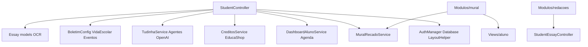

# Etapa 2 — Inventário e proposta: StudentController

**Data:** 2026-11-20  
**Status:** análise + **mural migrado** (ver `ETAPA2_MURAL_MIGRACAO.md`) — demais fatias aguardam aprovação  
**Alvo:** `backend/app/Painel/User/Controllers/StudentController.php` (~8183 linhas)  
**Referência wiki:** `backend/doc_sistema/estrutura.md` § “Ainda fora de módulo”

---

## Entregáveis

1. Inventário de responsabilidades (tabela abaixo)
2. Mapa de dependências
3. Proposta de modularização
4. Primeira candidata: **mural do aluno**
5. Plano de implementação e testes (pós-aprovação)

---

## 1. Inventário — métodos públicos

| Método | Responsabilidade | Módulo destino | Dependências | Risco | Testes necessários |
|---|---|---|---|---|---|
| `dashboard`, `dashboardApiMontar`, `dashboardAgendaJson`, `trocarTurmaCurso` | Home / shell do aluno | **Painel/Aluno** (permanece) | DashboardAlunoService, StudentAgendaService, SQL mural/jornadas/provas | Alto | Caracterização JSON + smoke |
| `alterarSenhaObrigatoria`, `processarAlteracaoSenha` | Senha obrigatória | Painel/Auth ou User | AuthManager, CSRF | Médio | CSRF + password_hash |
| `perfil` | Perfil | Painel/Aluno | alunos | Baixo | Smoke |
| `desempenhoJornadas` | Desempenho jornadas | `jornadas` | SQL progresso | Médio | Contagens |
| `desempenhoProvas` | Desempenho provas | `provas` | Exam, SQL matriz | Alto | Caracterização matriz |
| `notas`, `boletim`, `notasBoletins` | Notas / boletim portal | `boletins` (+ vida-escolar, eventos) | BoletimConfig, VidaEscolarService | **Alto — não migrar agora** | Evitar nesta etapa |
| `carteira*`, `educaShop*` | Créditos / shop / Asaas | educahits / créditos | CreditosService, EducaShopService | Médio–Alto | Status compra |
| **`muralRecados`, `marcarVistoMuralRecado`** | Mural aluno | **`mural`** | Já usa MuralRecadoService; view módulo existe | **Baixo** | Listagem + visto + CSRF |
| `chat`, conversas, uploads, voz, imagem, flashcard, stream… | Tudinha / chat IA | comunicacao / Agentes | TudinhaService, créditos, agentes | **Alto** | Suite ampla |
| `exercises`, `startExercise`, `submitExerciseAnswer` | Exercícios | `exercicios` | SQL listas | Médio | — (rotas comentadas em student.php) |
| `essays`, escrever/histórico/rascunho/OCR/corrigir… | Redação legada | `redacoes` | Essay* models | Alto | Já existe StudentEssayController (configurável); rotas ainda apontam para StudentController |
| `salvarRedacaoJornada`, `finalizarRedacaoJornada` | Redação em jornada | `jornadas` | SQL jornadas | Alto | Caracterização |
| `planosAula`, `visualizarPlanoAula` | Planos de aula | `jornadas` (rota já no módulo) | SQL planos | Baixo–Médio | Smoke URL |
| `calendarioLetivo` | Calendário | Dominio/Escola ou Painel | SchoolCalendarService | Baixo | Smoke |

### Helpers privados (amostra)

| Grupo | Exemplos | Destino natural |
|---|---|---|
| Mural | `countMural*`, `getMuralRecados*`, `buildMuralRecados*` | `MuralRecadoService` |
| Provas/boletim | `buildProvasMatrizPorBlocoAplicado`, `boletinsVisiveisNoPortal` | Services em `provas`/`boletins` |
| Dashboard | `getActiveJourneys`, `getProvasDisponiveisAgoraCount` | DashboardAlunoService |
| Redação/limites | `podeExecutarAcao`, `processEssayCorrection` | módulo redacoes |

### Rotas (onde vivem hoje)

- Maioria em `backend/config/routes/student.php` → `User/StudentController@…`
- Redações: `Modulos/redacoes/routes.php` → ainda `User/StudentController`
- Planos / redação jornada: `Modulos/jornadas/routes.php` → `User/StudentController`
- Mural admin/professor: já em `Modulos/mural/routes.php`; **aluno ainda no student.php**

### Testes existentes

Nenhum PHPUnit/Playwright dedicado ao StudentController ou mural aluno. SEC-10 cobre ownership de mídia/chat de forma lateral.

---

## 2. Mapa de dependências

**Preservar:** sessão aluno, PDO tenant, CSRF, FeatureGate, créditos.  
**Evitar:** dependência circular módulo → StudentController; mural importar provas/redacoes.

---

## 3. Proposta de modularização (ordem)

1. **mural** (primeira fatia)
2. **jornadas** — planos-aula
3. **redacoes** — realinhar rotas / extrair legado sem duplicar StudentEssayController
4. **exercicios**
5. Carteira / EducaShop
6. Tudinha/chat (por último)
7. Notas/boletim — só com decisão explícita
8. Dashboard — permanece no Painel

Padrão por fatia: Controller magro no módulo → Service → Views do módulo → mesmas URLs → remover do StudentController.

---

## 4. Primeira candidata: Mural do aluno

### Por quê

- 2 endpoints públicos + helpers
- Já usa `App\Modulos\Mural\Services\MuralRecadoService`
- Módulo tem Admin/Teacher + `Views/aluno/index.php`
- Sem regras acadêmicas
- Comportamento fácil de caracterizar (GET lista, POST marcar visto)

### Antes → Depois

| | Antes | Depois proposto |
|---|---|---|
| Rotas | `student.php` → StudentController | `mural/routes.php` → `AlunoMuralController` (mesmas URLs) |
| SQL/filtros | Helpers no StudentController | `MuralRecadoService` |
| View | `student/mural-recados/index` (legado) | View do módulo `mural/Views/aluno` (alinhar vars) |
| Dashboard counts | Helpers privados | Chamar o mesmo Service |

### Impactos

- URLs `/mural-recados` e `/mural-recados/marcar-visto` inalteradas
- CSRF e JSON de `marcarVisto` preservados
- Contadores do dashboard precisam passar pelo Service

### Rollback

Reapontar rotas para `User/StudentController` + git revert da fatia. Sem migration.

### Testes (antes de migrar)

1. Caracterização PHPUnit do Service (listar por turma, marcar visto, ownership `aluno_id`)
2. Smoke: GET 200; POST sem `_token` falha; com token ok

### Implementação (após “Aprovar mural”)

1. Testes de caracterização  
2. Completar Service com SQL atual  
3. Criar `AlunoMuralController`  
4. Rotas no módulo; remover de `student.php`  
5. Limpar métodos do StudentController; dashboard → Service  
6. Testes + smoke + relatório  

---

## 5. Restrições (mantidas)

Não refatorar o Controller inteiro · não tocar boletim/fechamento/notas · sem migrations · sem deploy · uma fatia por vez.

---

## Como aprovar

- `Aprovar mural` — autoriza caracterização + migração só do mural aluno  
- `Aprovar só inventário` — este arquivo já é o inventário; não migrar  
- Ou indique outra fatia (ex. `planos-aula`)

*Nenhum código de produto foi alterado nesta análise além deste documento de inventário.*
