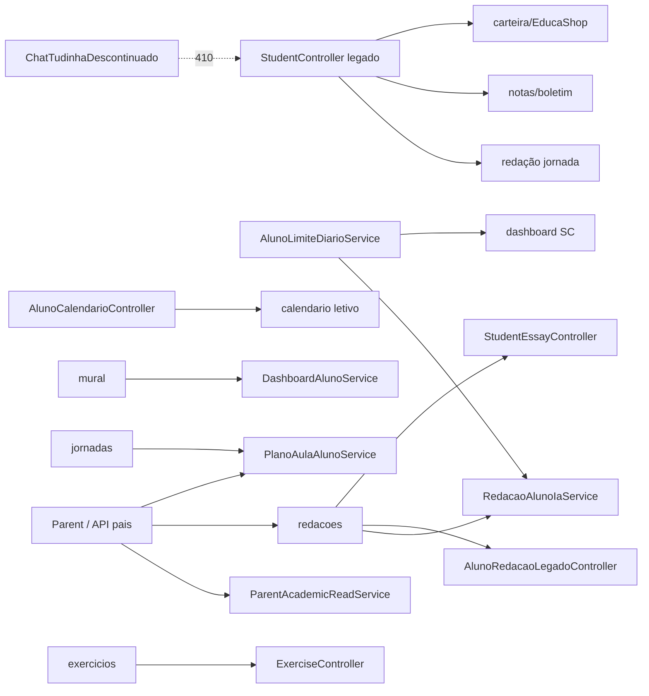

# Mapa de acoplamento entre módulos

**Data:** 2026-11-21 (atualizado Etapa 8)  
**Fonte:** código atual + `estrutura.md`

---

## Grafo simplificado

## Dependências observadas

| De | Para | Tipo | Risco |
|---|---|---|---|
| DashboardAlunoService | MuralRecadoService | contagem | Baixo (consolidado) |
| AlunoMuralController | DashboardAlunoService | invalidar cache | Baixo |
| jornadas | planos_aula (tabela) | SQL | Médio |
| redacoes configurável | Models Essays | domínio | Médio |
| RedacaoAlunoIaService | AlunoLimiteDiarioService | limites | Baixo (Etapa 8) |
| StudentController | OpenAI / créditos (jornada) | IA | **Alto** |
| StudentController | TudinhaService (jornadas) | streaming | Médio |
| provas ↔ jornadas | objetivos plano | leitura | Baixo |

## Rotas ainda no legado (SC)

- Carteira / EducaShop → `StudentController`
- Notas/boletim → `StudentController` (não migrar sem decisão)
- Redação de jornada (`salvar`/`finalizar`) → `StudentController`
- Dashboard / desempenho → `StudentController`

## Já fora do SC

- Hub + POST IA redações → `AlunoRedacaoLegado*`
- Chat Tudinha → 410 (`ChatTudinhaDescontinuadoController`)
- Calendário letivo aluno → `AlunoCalendarioController`
- Limites diários → `AlunoLimiteDiarioService`

## Duplicações conhecidas

- SQL planos (aluno service vs ParentController vs API) — filtro `aprovado` alinhado; drift residual documentado.
- `listarParaAluno` mural vs `sqlBaseVisibilidadeAluno` — risco de drift (já documentado).
- Calendário professor/pais ainda em `TeacherController` / `ParentController` (não unificado nesta etapa).

## Circularidades

Nenhuma circularidade dura módulo→módulo. Risco maior: Controllers legados chamando Services de vários módulos.
