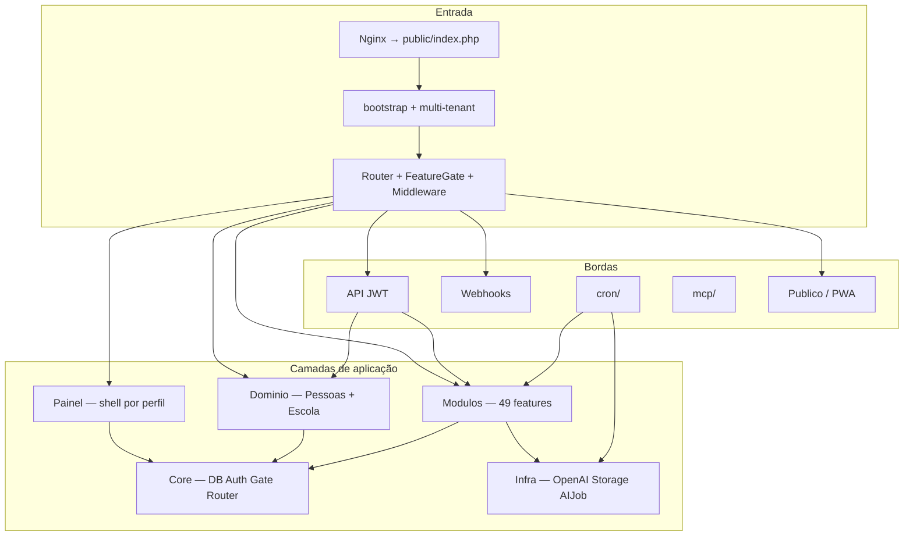
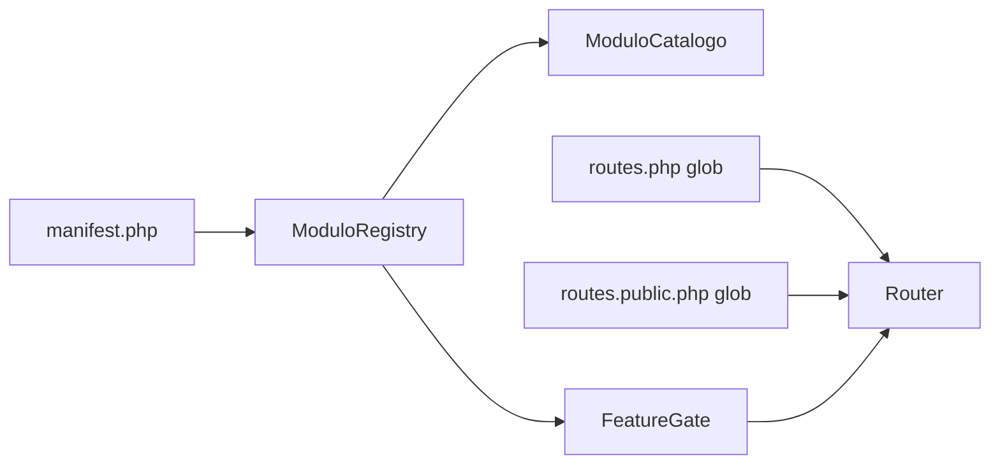
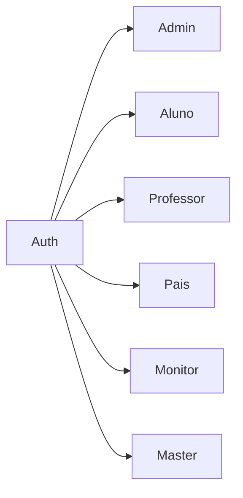
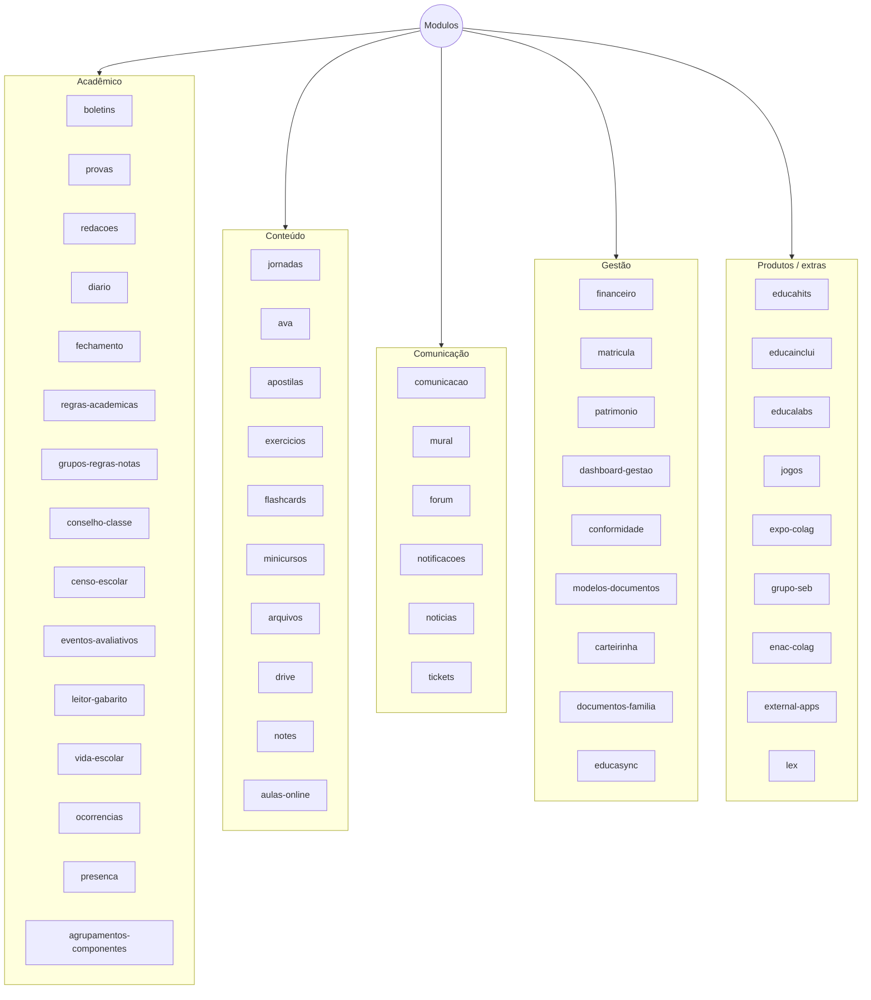
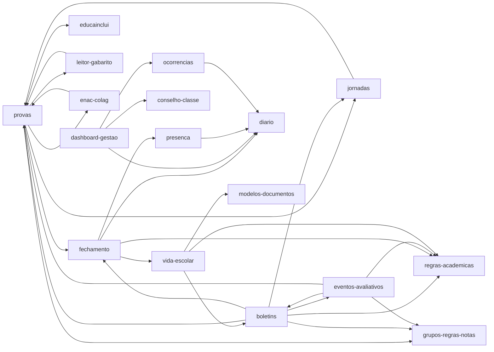
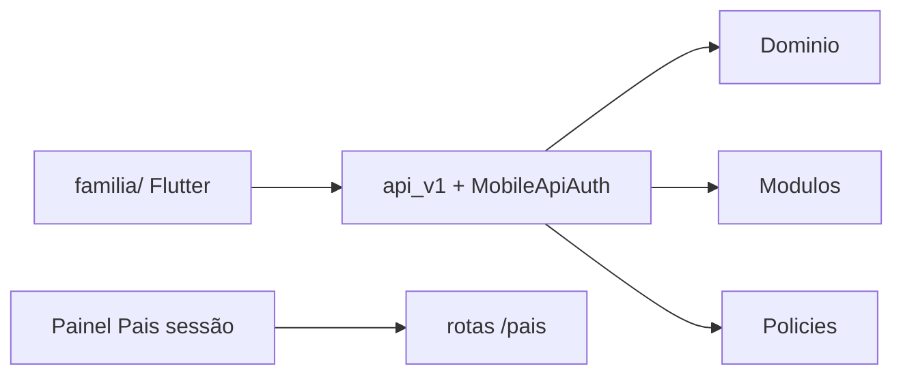
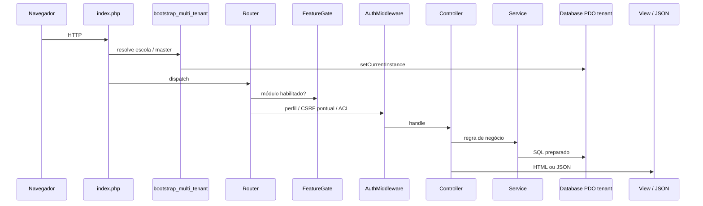

# Mapa de Módulos — EducaTudo

**Data:** 2026-11-20  
**Escopo:** `backend/app/` — Painel, Domínio, Módulos, API e bordas  
**Método:** somente leitura · evidências com paths  

> **[FATO]** / **[INFERÊNCIA]** / **[NÃO VERIFICADO]** conforme a ficha técnica.

---

## 1. Visão geral das camadas



**[FATO]** alinhado a `backend/doc_sistema/mapa.md`.

---

## 2. Como um módulo existe no sistema

### 2.1 Contrato físico

```
backend/app/Modulos/<chave>/
├── Controllers/
├── Models/          (opcional)
├── Services/        (opcional)
├── Views/<perfil>/
├── routes.php       (rotas autenticadas — 46/49 módulos)
├── routes.public.php(opcional — 11/49)
└── manifest.php     (obrigatório — 49/49)
```

**[FATO]** contagem: 49 pastas com `manifest.php` em `backend/app/Modulos/`.

### 2.2 Registro e descoberta



| Peça | Path | Papel |
|---|---|---|
| Registry | `app/Core/ModuloRegistry.php` | `scandir` + index por `chave` |
| Catálogo Master | `app/Core/ModuloCatalogo.php` | comercial / toggles |
| Gate de rota | `app/Core/FeatureGate.php` | bloqueia URI se módulo off |
| Rotas | `config/routes.php` | inclui globs de módulos |

**[INFERÊNCIA]:** o modelo é *convenção de pasta + include PHP*, não plugin com DI ou processo isolado. Módulos **não** são deployáveis sozinhos.

---

## 3. Domínio essencial (sempre presente)

### 3.1 `Dominio/Pessoas`

| Aspecto | Conteúdo |
|---|---|
| Responsabilidade | Cadastro e ciclo de vida de alunos, professores, monitores, responsáveis, avatares |
| Controllers | `StudentAdminController`, `TeacherAdminController`, `MonitorAdminController`, … |
| Models | `Student`, `Teacher`, `Monitor`, `ParentModel`, … |
| Services | perfil, movimentação, turma resolver, leitura acadêmica para pais, importações |

### 3.2 `Dominio/Escola`

| Aspecto | Conteúdo |
|---|---|
| Responsabilidade | Estrutura acadêmica: ano letivo, turmas, séries, cursos, BNCC, matriz, salas, unidades, calendário, grade |
| Controllers | ano letivo, `ClassController`, componentes, unidades, calendário, … |
| Models | `ClassRoom`, `ComponenteCurricular`, `MatrizCurricular`, `Sala`, `SchoolUnit`, … |
| Services | implantação acadêmica, grade, calendário, dashboards |

**[FATO]** regra documentada: essencial fica em Domínio; feature opcional em `Modulos/`.

---

## 4. Painel (shell) vs legado

### 4.1 Shell por perfil (proposital)



Pastas: `app/Painel/{Admin,Aluno,Professor,Pais,Monitor,Master,Auth,User,Integrations}/`.

Ficam no Painel de propósito: login, homes, permissões, créditos da escola, wiki, hubs e o Master SaaS.

### 4.2 Ainda concentrado no Painel (dívida modular)

| Local | Linhas (aprox.) | Conteúdo que deveria viver em módulo |
|---|---:|---|
| `Painel/User/Controllers/StudentController.php` | ~8183 | chat, redação, notas, boletim, mural, carteira, planos… |
| `Painel/User/Controllers/TeacherController.php` | ~2637 | exercícios / relatórios |
| `Painel/User/Controllers/ParentController.php` | ~1974 | acompanhamento do filho |
| `Painel/Admin/.../ReportAdminController.php` | ~4604 | relatórios (sem `Modulos/relatorios/`) |
| `Painel/Aluno/.../AgendaController.php` | — | agenda (sem módulo dedicado) |

**[FATO]** listagem em `backend/doc_sistema/estrutura.md` § “Ainda fora de módulo”.

---

## 5. Catálogo dos 49 módulos por domínio funcional

### 5.1 Diagrama por grupo



**[FATO]** lista completa em `backend/doc_sistema/estrutura.md` e pastas físicas.

### 5.2 Lista completa (chave → responsabilidade)

| Chave | Responsabilidade resumida |
|---|---|
| `agrupamentos-componentes` | Disciplinas compostas / áreas |
| `apostilas` | Apostilas e material (+ IA) |
| `arquivos` | Materiais da turma |
| `aulas-online` | Aulas ao vivo / JaaS |
| `ava` | AVA/EAD (cursos, certificados) |
| `boletins` | Boletim, médias, portal de notas |
| `carteirinha` | Carteirinha + validação pública |
| `censo-escolar` | Censo INEP |
| `comunicacao` | Comunicados, reuniões, chat escolar |
| `conformidade` | Auditoria / conformidade |
| `conselho-classe` | Sessões, atas, deliberações |
| `dashboard-gestao` | Home admin + widgets |
| `diario` | Diário de classe |
| `documentos-familia` | Docs/declarações à família |
| `drive` | Drive de arquivos |
| `educahits` | Produto EducaHits |
| `educainclui` | Acessibilidade |
| `educalabs` | Labs / experiências |
| `educasync` | Grade horária (solver externo) |
| `enac-colag` | Import ENAC → nota |
| `eventos-avaliativos` | Modelo de eventos avaliativos |
| `exercicios` | Exercícios |
| `expo-colag` | Evento COLAG |
| `external-apps` | Apps externos / tokens |
| `fechamento` | Fechamento de período/turma |
| `financeiro` | Planos, boletos, DRE |
| `flashcards` | Flashcards (+ fila IA) |
| `forum` | Fórum |
| `grupo-seb` | Skin portal aluno |
| `grupos-regras-notas` | Quadro de regras de notas |
| `jogos` | Jogos educacionais |
| `jornadas` | Jornadas de aprendizado |
| `leitor-gabarito` | OCR / leitura de gabarito |
| `lex` | Login LEX (OAuth) |
| `matricula` | Funil de matrícula + ZapSign |
| `minicursos` | Minicursos |
| `modelos-documentos` | Layouts de docs oficiais |
| `mural` | Mural de recados |
| `notes` | Notes / Meu Caderno |
| `noticias` | Feed / RSS |
| `notificacoes` | Notificações e push |
| `ocorrencias` | Ocorrências do aluno |
| `patrimonio` | Patrimônio / almoxarifado |
| `presenca` | Frequência (+ facial) |
| `provas` | Provas online, blocos, matriz |
| `redacoes` | Redações e correção |
| `regras-academicas` | Aprovação / progressão |
| `tickets` | Tickets de suporte do aluno |
| `vida-escolar` | Ficha, trajetória, ofícios |

Módulos sem `routes.php` próprio: `external-apps`, `lex`, `noticias` (usam `routes.public.php` e/ou Master). **[FATO]**

---

## 6. Dependências entre módulos (acoplamento real)

### 6.1 Grafo de `use App\Modulos\…` cruzado

**[FATO]** amostragem: **14/49** módulos importam outro módulo; **35/49** sem `use` cruzado.



**Hubs (incoming):** Provas, Diário, Regras Acadêmicas, Fechamento, Grupos de Regras de Notas.

**Core compartilhado (todos):** `Database`, `FeatureGate`, `LayoutHelper`, créditos (`CreditosModuleRegistry` / `CreditosService`).

---

## 7. Fichas dos módulos principais

Legenda de evolução independente: capacidade de evoluir/versionar o módulo sem redesenhar o cluster acadêmico.

| Módulo | Responsabilidade | Dirs principais | Deps módulos | DB | Acoplamento | Evolução indep. |
|---|---|---|---|---|---|---|
| **provas** | Provas online, blocos, matriz, assistentes | C/M/S + Views | EducaInclui, EnacColag, Fechamento, GRN, Jornadas, LeitorGabarito | PDO tenant | Alto | Não |
| **boletins** | Modelo de boletim, médias, assistente | C/M/S | Eventos, Fechamento, GRN, Jornadas, Provas, Regras | PDO tenant | Alto | Não |
| **fechamento** | Fechamento e homologação | C/M/S | Diário, Presença, Regras, Vida Escolar | PDO tenant | Alto | Não |
| **jornadas** | Jornadas / planos | C/M/S | Provas (+ restos no StudentController) | PDO tenant | Médio | Parcial |
| **ava** | EAD / certificados | C/M/S | Pouco cruzamento visto | PDO tenant | Baixo–médio | Sim (c/ Core) |
| **financeiro** | Planos, boletos, DRE | C/M/S | Isolado entre módulos | PDO tenant | Baixo | Sim |
| **matricula** | Funil + ZapSign | C/M/S + public | Isolado; webhook | PDO tenant | Baixo | Sim |
| **diario** | Diário de classe | C/M/S | Hub *incoming* | PDO tenant | Médio | Parcial |
| **comunicacao** | Comunicados / reuniões | C/S | Isolado | PDO / SQL em services | Baixo | Sim |
| **drive** | Arquivos | C/M/S | Isolado | PDO tenant | Baixo | Sim |
| **redacoes** | Propostas / correção | C/M/S | Isolado; restos no Painel | PDO tenant | Médio (Painel) | Parcial |
| **vida-escolar** | Ficha / ofícios | C/M/S | Boletins, Modelos, Regras | PDO tenant | Alto | Não |

Acesso a banco: **sempre** via conexão do tenant atual (`Database::getInstance()`), não por filtro `escola_id`. **[FATO]** de mecanismo; auditoria linha a linha de todas as queries **[NÃO VERIFICADO]**.

Reutilização compartilhada típica: `BaseController`, `Logger`, `AIJobService`, `OpenAIService`, `MediaStorageService`, Policies pontuais, View layouts.

---

## 8. Bordas: API, Webhooks, Cron, MCP

### 8.1 API JWT



| Superfície | Path |
|---|---|
| Pais legado | `API/Controllers/ParentController.php` + `routes/public.php` |
| Mobile v1 | `API/Controllers/V1/*` + `routes/api_v1.php` |
| Facial | `FacialDeviceApiController` → módulo Presença |

### 8.2 Webhooks

`app/Webhooks/Controllers/` — JaaS, Jitsi recording, ZapSign, etc. Regra de projeto: validar HMAC.

### 8.3 Cron

`backend/cron/` — `process_ai_jobs.php`, Asaas, TudiCoins, jornadas, presença, financeiro, backup, gabarito, KPIs master, etc. Multi-tenant via `CronMultiTenantHelper` (itera escolas).

### 8.4 MCP

`backend/mcp/{assistente-consulta,boletim-assistente,jornadas-aluno,provas-aluno,provas-professor}/` — tools para assistentes de IA.

---

## 9. Comunicação entre componentes (request típico)



---

## 10. Policies e autorização transversal

| Artefato | Papel |
|---|---|
| `AuthMiddleware` | Sessão + perfil |
| `AdminPermissionMatrix` | ACL granular do admin |
| `FeatureGate` | Módulo ligado/desligado |
| `ParentStudentAccessPolicy` | Pai ↔ filho (API) |
| `PoliticaAcessoProfessorAluno` | Professor ↔ aluno (ex.: chat) |
| TudiCoins / créditos | Gate de consumo de IA por módulo |

**[FATO]:** só 2 policies em `app/Policies/`. A maior parte da autorização está em middleware + checks locais em controllers/services.

---

## 11. Compat / legado de namespaces

`app/Compat/*_autoload.php` + maps (`controllers_map`, `models_map`, `services_map`, …) fazem `class_alias` de FQCNs antigos (`App\Controllers\ExamController`) para namespaces novos em `Modulos/`.

**[INFERÊNCIA]:** migração física das pastas avançou; o contrato de nomes legados ainda é necessário para includes antigos — remoção em lote é arriscada.

---

## 12. Síntese para o CTO

1. Existe um **mapa claro** Painel / Domínio / Módulos / Bordas.
2. Produtos laterais (financeiro, matrícula, drive, comunicação, AVA) têm **limites relativamente limpos**.
3. O **núcleo acadêmico** (provas ↔ boletins ↔ fechamento ↔ regras ↔ diário) é um **grafo acoplado** — trate-o como um único bounded context até haver APIs internas explícitas.
4. O maior ruído de mapa hoje não são as 49 pastas: é o **Painel/User** ainda funcionando como “super-módulo”.

---

*Complementa: `ARQUITETURA_TECNICA_EDUCATUDO.md` · `DIAGNOSTICO_ARQUITETURAL.md` · `PLANO_EVOLUCAO_ARQUITETURAL.md`*
