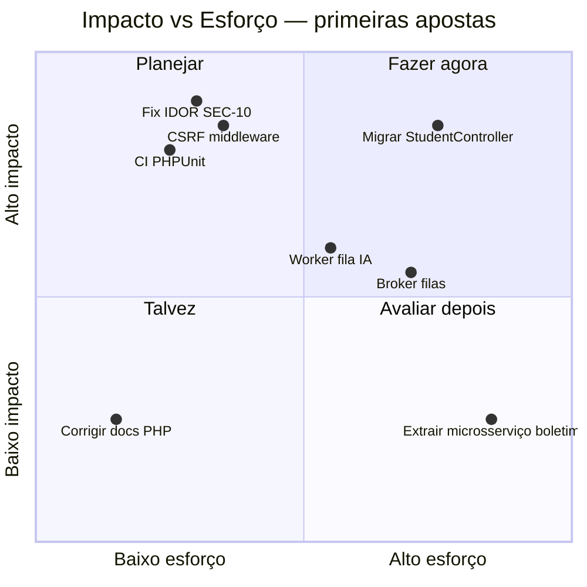

# Plano de Evolução Arquitetural — EducaTudo

**Data:** 2026-11-20  
**Base:** achados de `ARQUITETURA_TECNICA_EDUCATUDO.md`, `MAPA_MODULOS_EDUCATUDO.md` e `DIAGNOSTICO_ARQUITETURAL.md`  
**Princípio:** evoluir o monólito modular com evidência; extrair serviços só com critério objetivo.

> Estimativas de esforço: **P** (dias), **M** (1–3 sprints), **G** (múltiplos sprints).  
> Impacto / risco: **Alto | Médio | Baixo**.

---

## 1. Norte arquitetural (o que preservar)

1. **Um MySQL por escola + Master** — não reintroduzir `WHERE escola_id` no tenant.
2. **Painel / Domínio / Módulos** — shell fino; regra de negócio no módulo; essencial no Domínio.
3. **FeatureGate + créditos** — comercialização e TudiCoins no Core.
4. **PHP-FPM request-scoped** — não usar `Database::setCurrentInstance` em workers multi-tenant concorrentes sem redesenho.
5. **Satélites só onde já há fronteira** (solver, apostila-ai, ws) ou onde escala exigir.

---

## 2. Curto prazo (0–90 dias)

Objetivo: reduzir risco imediato (segurança + regressão) sem redesign amplo.

| ID | Ação | Esforço | Impacto | Risco da mudança | Evidência / motivação |
|---|---|---|---|---|---|
| C1 | Fechar e regressar IDOR SEC-10 (chat professor e correlatos) | P–M | Alto | Baixo | `correcao-sec-10-*`, auditoria SEC-10 |
| C2 | Introduzir **middleware CSRF** para POST web (exceto `/api/*` JWT) | M | Alto | Médio | CSRF hoje só por controller |
| C3 | Pipeline CI: `phpunit` + lint básico em PR (antes ou junto do deploy) | P–M | Alto | Baixo | Só `deploy-main.yml` hoje |
| C4 | Smoke Playwright: login multi-perfil + 1 fluxo ownership | P | Médio | Baixo | Poucos specs E2E |
| C5 | Inventário de endpoints sem ownership explícito (aluno/professor/pais) | M | Alto | Baixo | Policies só 2 arquivos |
| C6 | Congelar crescimento de `Painel/User/*`: código novo só em `Modulos/` | P (processo) | Médio | Baixo | StudentController ~8k |
| C7 | Corrigir drift documental (PHP 8.x, description Composer multi-tenant) | P | Baixo | Baixo | Docs vs Docker / composer.json |
| C8 | Checklist de review: prepared statements + ownership + CSRF | P (processo) | Médio | Baixo | Regras já existem; adesão desigual |

### Critérios de pronto (curto prazo)

- [ ] Casos SEC-10 críticos com teste automatizado ou checklist executável.
- [ ] CSRF centralizado nas rotas web autenticadas.
- [ ] PR não mergeia vermelho em PHPUnit (ao menos suite atual).
- [ ] Nenhuma feature nova adicionada em `StudentController` / `TeacherController` / `ParentController`.

---

## 3. Médio prazo (3–9 meses)

Objetivo: tornar a modularidade **efetiva** nos hotspots e melhorar testabilidade.

| ID | Ação | Esforço | Impacto | Risco | Notas |
|---|---|---|---|---|---|
| M1 | Migrar fluxos restantes de `StudentController` → módulos (`comunicacao`, `redacoes`, `boletins`, `mural`, `jornadas`, …) | G | Alto | Médio | Já mapeado em `estrutura.md` |
| M2 | Migrar `TeacherController` / `ParentController` análogos | G | Alto | Médio | Idem |
| M3 | Extrair Services dos Controllers >2k linhas (começar por provas, boletins, jornadas) | G | Alto | Médio | Reduz SQL no Controller |
| M4 | Definir **API interna** (facades/services públicos) no cluster acadêmico provas↔boletins↔fechamento | M–G | Alto | Médio | Preparação para evolução sem microserviço |
| M5 | Ampliar Policies (ou guards) para recursos sensíveis: chat, mídia, notas, documentos | M | Alto | Médio | Complementa FeatureGate/ACL |
| M6 | Padronizar DI leve nos novos Services (construtor + interfaces nos limites) | M | Médio | Baixo | Sem reescrever o Core de uma vez |
| M7 | Observabilidade: correlação `TENANT_ID` + request-id nos logs; métricas de fila IA | M | Médio | Baixo | Logger já existe |
| M8 | Worker dedicado de `ai_jobs` (container/serviço) separado do request web | M | Médio | Médio | Hoje cron + spawn CLI |
| M9 | Garantir storage S3 em ambientes multi-instância; eliminar dependência de disco local compartilhado | M | Alto (se multi-node) | Médio | Condicional à topologia |
| M10 | Suite E2E dos fluxos críticos: prova, boletim, matrícula, financeiro, API pais | M–G | Alto | Baixo | `tests/` + `qa/` |
| M11 | Remoção incremental de aliases Compat (por módulo, com grep + testes) | M contínuo | Médio | Médio | Não deletar em lote |
| M12 | Módulo `relatorios` e `agenda` (sair do Painel Admin/Aluno) | M | Médio | Baixo | Lacunas documentadas |

### Critérios de pronto (médio prazo)

- [ ] `Painel/User` reduzido a wrappers finos ou removido.
- [ ] Controllers acadêmicos principais sem SQL direto (ou exceções justificadas).
- [ ] Fila IA operando com worker dedicado e métricas.
- [ ] Cluster acadêmico com fachadas estáveis entre módulos.

---

## 4. Longo prazo (9–24 meses)

Objetivo: escala e fronteiras de produto — **sem** big-bang de microsserviços.

| ID | Ação | Esforço | Impacto | Risco | Critério objetivo para avançar |
|---|---|---|---|---|---|
| L1 | Avaliar broker de filas (Redis Streams / SQS) se throughput de IA/OCR estourar MySQL | G | Alto | Médio | SLOs de fila violados de forma recorrente |
| L2 | Extrair serviços só com fronteira clara (já iniciado: solver, apostila-ai; candidatos: leitor-gabarito OCR, geração pesada de PDF) | G | Médio–Alto | Alto | Ciclo de release/SLA distintos + API estável |
| L3 | Bounded context acadêmico versionado (pacote interno ou módulo com contrato) | G | Alto | Médio | Times paralelos no mesmo núcleo |
| L4 | Read models / réplicas para relatórios pesados (se necessário) | G | Médio | Médio | Contenção de leitura comprovada |
| L5 | App `familia/` e API mobile como contrato OpenAPI publicado e testado em CI | M–G | Médio | Baixo | Divergência docs×código hoje |
| L6 | Estratégia de multi-região / HA **somente após** evidência de necessidade | G | Alto | Alto | Requisitos de negócio + métricas |
| L7 | Reduzir monólito de assets (JS modular) se complexidade front crescer | M–G | Baixo–Médio | Médio | Dor real de manutenção front |

### O que explicitamente **não** fazer no longo prazo sem gatilho

- Quebrar provas/boletins/fechamento em microsserviços separados.
- Introduzir service mesh / event-sourcing completo “por padrão”.
- Migrar o monólito para framework (Laravel/Symfony) sem business case de contratação/produtividade — custo de migração seria G e alto risco.

---

## 5. Priorização sugerida (matriz)

Interpretação prática:

1. **Agora:** C1–C4, C6 (segurança + qualidade de entrega).
2. **Em seguida:** M1–M5, M8 (modularidade real + operação IA).
3. **Depois / sob demanda:** L1–L4 (escala e extrações).

---

## 6. Indicadores para acompanhar a evolução

| Indicador | Como medir | Meta direcional |
|---|---|---|
| Tamanho dos top Controllers | `wc -l` nos hotspots | Tendência de queda trimestre a trimestre |
| % Controllers com SQL direto | grep em `*Controller.php` | Queda contínua |
| Cobertura de testes nos módulos críticos | PHPUnit + E2E por fluxo | Gate mínimo no CI |
| Tempo médio / falha de `ai_jobs` | logs + tabela | SLO definido pela operação |
| Incidentes IDOR / CSRF | tracker de segurança | Zero regressão pós-fix |
| Features novas em `Painel/User` | review / CODEOWNERS | Zero |

---

## 7. Papéis sugeridos

| Papel | Responsabilidade neste plano |
|---|---|
| CTO / Tech Lead | Priorizar C* vs M*; barrar microservicização precoce |
| Segurança | C1, C2, C5, M5; acompanhar SEC-* |
| Backend | M1–M4, M8; manter isolamento tenant |
| QA | C3–C4, M10; Playwright crítico |
| DevOps | CI, worker IA, Redis/S3, deploy com gates |
| Produto | Validar quais módulos merecem ciclo de release próprio (L2) |

---

## 8. Mensagem pronta para equipe externa

> O EducaTudo é um monólito modular PHP multi-tenant (DB por escola), com mapa claro de Painel/Domínio/Módulos e isolamento estrutural sólido. A evolução prioriza fechar gaps de autorização e CSRF, institucionalizar testes no CI, esvaziar Controllers legados do Painel e fortalecer o bounded context acadêmico **dentro** do monólito. Microsserviços ficam reservados a cargas com fronteira e necessidade operacional comprovadas — padrão já usado em solver e serviços de IA auxiliares.

---

*Fim do pacote de auditoria arquitetural 2026-11-20.*
