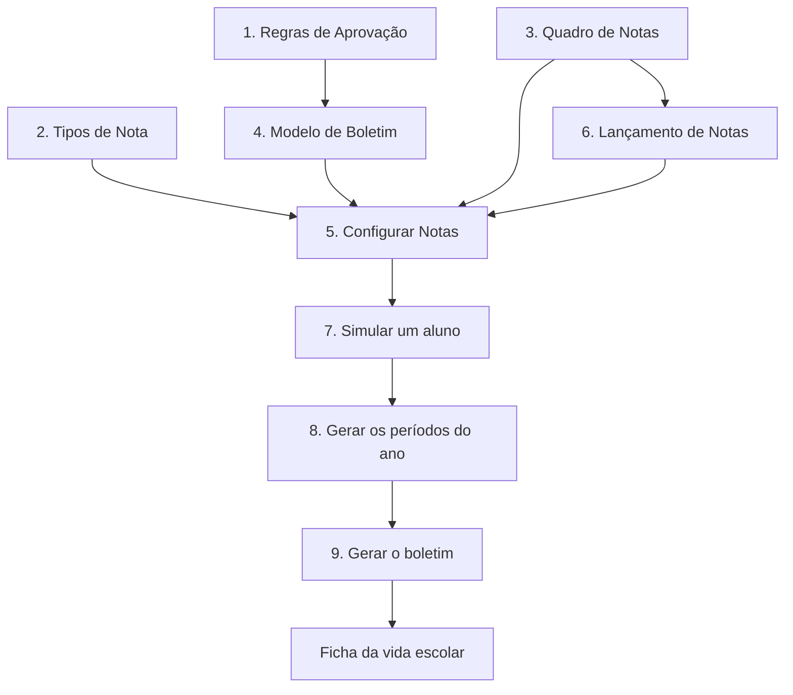

# Como a escola avalia — até gerar o boletim

Passo a passo do que a coordenação configura e do que ela faz no ano, até o boletim do período existir.

A nota digitada e o boletim impresso não nascem na mesma tela. O **Quadro de Notas** é o molde das colunas. O **Lançamento de Notas** é onde a nota entra. O **Modelo de Boletim** é o documento. **Configurar Notas** é a fórmula que transforma as colunas na média do período. Só depois disso a escola gera o boletim.

A divisão do ano (bimestre, trimestre, semestre ou etapa única) vem do **Ano Letivo**. Prova, boletim e fechamento usam essa divisão.

## O que já precisa existir

Sem isso, a avaliação não tem turma nem aluno para calcular.

| Ordem | Tela | Para quê |
|---|---|---|
| 1 | Ano Letivo (`/admin/ano-letivo`) | Ano ativo, datas e a divisão do período |
| 2 | Cursos e Séries (`/admin/cursos-series`) | O percurso. Curso com progressão anual precisa de série |
| 3 | Componentes Curriculares (`/admin/componentes-curriculares`) | As disciplinas. “Permite avaliação” marcado para quem recebe nota |
| 4 | Matriz Curricular (`/admin/matrizes-curriculares`) | Quais disciplinas da série entram no boletim, e com qual carga |
| 5 | Calendário Letivo (`/admin/calendario-letivo`) | Dias letivos, feriados e as datas de avaliação do ano |
| 6 | Professores, Salas, Turmas | A turma aponta curso, série, ano e matriz |
| 7 | Alunos matriculados | Cadastro e matrícula são dois atos. Sem matrícula ativa, o aluno não entra em nota nem em boletim |
| 8 | Grade Horária (`/admin/grade-horaria`) | O diário sabe qual aula lançar. A frequência que a regra usa sai daqui |

A trilha `/admin/implantar-academico` confere esses itens no ano civil corrente.

## Caminho

## 1. Regras de Aprovação

Tela: `/admin/regras-academicas`

Aqui a escola diz o que é ser aprovado: média mínima, se a frequência também reprova, recuperação, arredondamento e casas decimais. A regra vale para um ano letivo. Alterar 2026 não reescreve 2025.

O boletim não pede a mínima de novo. Ele aponta para esta regra. Sem regra ativa, a geração usa 6,0.

## 2. Tipos de Nota

Tela: `/admin/provas/tipos-avaliacao`

Cada natureza de nota que a escola aplica: prova bimestral, trabalho, simulado. Define se é online ou a escola informa a nota, se acontece uma vez no período ou várias vezes, e a escala.

O lançamento usa o tipo para classificar a nota. A fórmula do boletim usa essas peças.

## 3. Quadro de Notas

Tela: `/admin/quadros-notas`

É o molde do painel, não o boletim. A escola cria as colunas onde cada nota cai (S1, S2, AV1) e, se as disciplinas não compartilham as mesmas colunas, os blocos com as disciplinas de cada bloco.

Coluna de **lançamento** recebe a nota digitada. Coluna **calculada** fecha a nota da matéria. `vai_para_boletim` marca o que o documento oficial pode ler.

O modelo de boletim não tem campo de quadro. O quadro é apontado no evento, no passo seguinte e no lançamento.

## 4. Modelo de Boletim

Tela: `/admin/boletins`

É o documento: nome, ano impresso, oficial ou extra, regra de aprovação, disciplinas e o público (série, turma, quem vê).

- **Oficial** entra no histórico e na vida escolar.
- **Extra** é curso complementar e fica de fora dos dois.

Os anos desta tela são uma janela civil (ano atual, o seguinte e quatro para trás). A turma, no passo anterior, só oferece ano letivo cadastrado e ativo. As duas listas não precisam coincidir.

Daqui saem três ações, nesta ordem: configurar a fórmula, gerar os períodos do ano e gerar o boletim.

## 5. Configurar Notas

Tela: `/admin/boletim-configuracao/assistente`

Abre pelo modelo (Fórmulas) ou por um evento já salvo. Este assistente grava o **evento de notas**: a receita da média de um período. Os passos são:

1. **Começar** — origem do evento.
2. **Identidade** — nome, ano, período e em qual boletim ele entra. O quadro também é escolhido aqui.
3. **Tipo de Notas** — as peças que compõem a média (bimestral, jornada, ENAC e o que a escola marcou).
4. **Agrupar** — se disciplinas viram uma linha só no boletim.
5. **Fórmula** — como as colunas viram a média.
6. **Revisão** — conferir e salvar.

**Nenhum**, no seletor de boletim, significa que o evento fica só no painel de notas. Ele não alimenta um modelo oficial. Para o boletim sair, a identidade precisa apontar o modelo ativo.

Sem boletim escolhido, a mínima mostrada é exemplo (6,0 ou a da regra). O público também não é o de uma turma até o modelo ser vinculado.

O primeiro período é montado aqui. Os demais períodos do ano são cópia deste, no passo 8.

## 6. Lançamento de Notas

Tela: `/admin/provas`

É o evento em que a nota é digitada ou a prova online acontece. Na criação, a escola aponta o **quadro** e a **coluna**. Turma e professores vêm juntos.

A nota lançada preenche a célula do quadro. A fórmula do passo 5 lê essa célula. Sem o quadro apontado, a nota existe no lançamento e não chega no boletim.

A lista abre em “Todos (exceto concluídos)”. O número do topo conta o estoque inteiro, inclusive os já encerrados. São duas contagens de propósito.

A data da lista é a data da prova. Se ela estiver vazia, a tela mostra o ano letivo do evento, não o dia em que o cadastro foi criado.

Duplicar um lançamento leva ano, período, formato e visibilidade no portal do original.

## 7. Simular um aluno

Tela: `/admin/boletins/{id}/simular` (também em Modelo de Boletim → Simular)

A coordenação escolhe o evento de notas e um aluno matriculado e confere a conta antes de gravar. Se a lista de alunos vier vazia, a turma ainda não tem matrícula ativa — o caminho é matricular ou importar em Cursos e Séries.

A simulação não publica o boletim.

## 8. Gerar os períodos do ano

Tela: `/admin/boletins/{id}/gerar-avaliacoes`

Copia o primeiro evento de notas para os outros períodos. As datas vêm do calendário letivo (tipo Avaliação). Sem essas datas, a tela oferece os períodos padrão do ano, limitados ao ano letivo.

Só entra evento já ligado a este modelo, ou evento do mesmo ano e da mesma série que já tenha geração vigente. Por isso este passo vem depois de salvar o primeiro período em Configurar Notas. Substituir um período desativa o evento antigo; o histórico daquele período deixa de valer.

## 9. Gerar o boletim

Tela: `/admin/boletins/{id}/gerar-boletins`

A coordenação escolhe o evento do período e gera em lote. O sistema:

1. Lê as notas lançadas nas colunas do quadro e as outras peças da fórmula.
2. Calcula a média do período.
3. Aplica a regra de aprovação (média, frequência, recuperação, arredondamento).
4. Grava o resultado do aluno. Esse registro é o boletim do período. Gerar de novo atualiza; não cria uma segunda conta paralela.

A frequência usada na situação vem do diário e da presença, não de um campo digitado nesta tela.

Os boletins gravados ficam em `/admin/boletim-configuracao/gerados`.

Se não houver evento válido, a mensagem pede para cadastrar o evento apontando para este boletim e gerar as notas antes. Se não houver aluno ativo nas séries do evento, a geração para.

## Onde o boletim aparece depois

Gerar o boletim preenche a média do período na **ficha de vida escolar** do aluno (`/admin/vida-escolar` e a aba de boletim no prontuário). A célula calculada acompanha essa média. Nota digitada à mão na ficha, ou nota vinda de outra escola, não é substituída por esse cálculo.

O PDF da ficha usa o regime do ano da ficha: bimestre, trimestre ou o que o Ano Letivo definiu.

Modelo **extra** não entra nessa ficha nem no histórico.

Homologar o ano (ata, ficha individual, boletim oficial congelado) é o módulo de **Resultados finais**, depois que o boletim do período já foi gerado. Essa etapa não recalcula a nota.

## O que cada peça responde

| Pergunta | Onde |
|---|---|
| A partir de quanto o aluno passa? | Regras de Aprovação |
| Que tipos de nota a escola aplica? | Tipos de Nota |
| Em qual coluna a AV1 cai? | Quadro de Notas |
| Onde a nota é digitada? | Lançamento de Notas |
| Qual documento a família recebe, e com qual regra? | Modelo de Boletim |
| Como as colunas viram a média do período? | Configurar Notas |
| O boletim deste bimestre já foi gravado? | Gerar o boletim |
